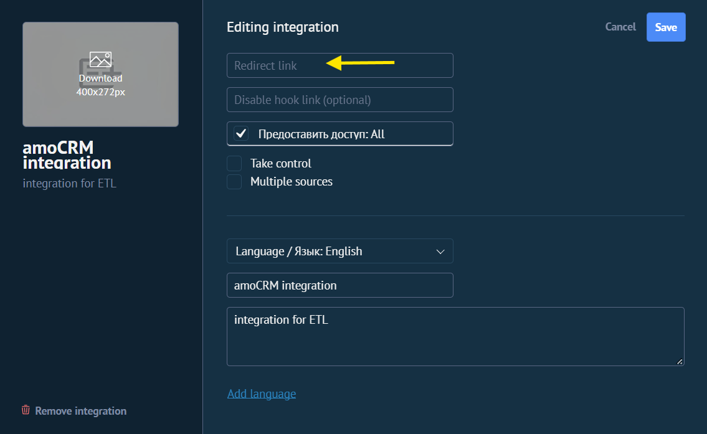

# amoCRM → PostgreSQL ETL

## 1. Loyiha haqida

Bu loyiha amoCRM'dagi **kontaktlar**, **kompaniyalar** va **bitimlarni** avtomatik olib, **PostgreSQL** bazasiga yozadi. Ma'lumotlar keyin tahlil uchun (SQL, Power BI va h.k.) tayyor turadi.

Ishlatilgan texnologiyalar: Python (pandas, SQLAlchemy), amocrm-api kutubxonasi, PostgreSQL, Apache Airflow va Docker.

## 2. Arxitektura

```
amoCRM  ──►  extracter.py  ──►  contacts.py / company.py / transactions.py  ──►  load.py  ──►  PostgreSQL
                                              ▲
                                  Airflow DAG (dag.py) har kuni ishga tushiradi
```

```
amoCRM/
├── dags/
│   ├── dag.py                # Airflow DAG: 3 task va jadval
│   └── pipelines/
│       ├── sozlamalar.py     # BARCHA sozlamalar (kalit, parol, host)
│       ├── extracter.py      # amoCRM'ga ulanish, ma'lumot olish
│       ├── load.py           # PostgreSQL'ga yozish
│       ├── functions.py      # yordamchi funksiyalar
│       ├── contacts.py       # kontaktlar pipeline'i
│       ├── company.py        # kompaniyalar pipeline'i
│       └── transactions.py   # bitimlar pipeline'i
├── docker-compose.yaml       # Airflow servislari
├── Dockerfile
├── requirements.txt
├── .env                      # FERNET_KEY, AIRFLOW_UID (Airflow uchun)
├── access_token.txt          # avtomatik yaratiladi
└── refresh_token.txt         # avtomatik yaratiladi
```

## 3. ETL jarayoni

1. **Extract:** `extracter.py` amoCRM'dan hamma kontakt, kompaniya va bitimlarni oladi. Token muddati tugasa, o'zi yangilaydi.
2. **Transform:** `contacts.py`, `company.py`, `transactions.py` xom ma'lumotdan kerakli ustunlarni ajratib, jadval (pandas DataFrame) tayyorlaydi (qo'shimcha maydonlar va teglar `functions.py` / `extracter.py` yordamida olinadi).
3. **Load:** `load.py` jadvallarni PostgreSQL'ning `amocrm` bazasiga `contacts`, `company`, `transactions` nomlari bilan yozadi. Har safar jadval yangidan yoziladi (eski ma'lumot almashadi).

Airflow'da tartib: `contacts → company → transactions`.

## 4. Qanday ishga tushiriladi (How to run)

### 4.1. Tayyorlash

Kerak: Python 3.13, PostgreSQL, Docker Desktop, Git.

```powershell
git clone <REPO_MANZILI>
cd amoCRM
python -m venv my_venv
my_venv\Scripts\activate
python -m pip install -r requirements.txt
```

### 4.2. Login va parollarni qayerdan olish

| Nima | Qayerdan olinadi |
|---|---|
| `AMO_CLIENT_ID` | amoCRM → Sozlamalar → Integratsiyalar → o'z integratsiyangiz → **Keys and accesses** → *Integration ID* |
| `AMO_CLIENT_SECRET` | Shu sahifada *Secret key* |
| `AMO_AUTH_CODE` | Shu sahifada *Authorization code* (20 daqiqa yashaydi, bir marta ishlaydi) |
| `AMO_SUBDOMAIN` | amoCRM manzilidagi nom: `https://BU_YERDA.amocrm.ru` |
| `AMO_REDIRECT_URL` | Integratsiya yaratayotganda **Redirect link** maydoniga yozgan manzilingiz (pastdagi rasmga qarang) |

#### `AMO_REDIRECT_URL` ga nima yozish kerak

amoCRM'da integratsiya yaratayotganda (yoki tahrirlayotganda) **Redirect link** maydoniga istalgan `https://...` manzilni yozasiz (masalan `https://ya.ru`). `sozlamalar.py` dagi `AMO_REDIRECT_URL` ga **aynan shu manzilni, harfma-harf bir xil** qilib yozing, aks holda amoCRM authorization code ni rad etadi.



```python
AMO_REDIRECT_URL = "https://ya.ru"   # amoCRM'dagi Redirect link bilan bir xil bo'lsin
```

Bu manzilga hech narsa yuborilmaydi (kodni amoCRM sahifasidan o'zingiz nusxalaysiz), shuning uchun u haqiqiy ishlaydigan sahifa bo'lishi shart emas.
| `DB_PASSWORD` | PostgreSQL'dagi `postgres` paroli. O'zingiz belgilaysiz: `ALTER USER postgres PASSWORD 'PAROL';` |
| `FERNET_KEY` | Terminalda yaratiladi (pastda) |

### 4.3. Sozlamalar faylini yaratish

Maxfiy bo'lgani uchun `sozlamalar.py` GitHub'da yo'q. `dags/pipelines/sozlamalar.py` nomli fayl yarating va to'ldiring:

```python
import os

# ===== SHU YERNI TO'LDIRING =====
AMO_CLIENT_ID = ""
AMO_CLIENT_SECRET = ""
AMO_SUBDOMAIN = ""
AMO_REDIRECT_URL = ""
AMO_AUTH_CODE = ""      # faqat birinchi marta yoziladi

DB_USER = ""
DB_PASSWORD = ""
DB_NAME = ""
DB_PORT = 5432
DB_HOST = "auto"        # "auto" = Docker/lokalni o'zi aniqlaydi
# ===== PASTGA TEGMANG =====

IN_DOCKER = os.path.exists("/.dockerenv")

if DB_HOST == "auto":
    DB_HOST = "host.docker.internal" if IN_DOCKER else "localhost"

if IN_DOCKER:
    TOKENS_DIR = "/opt/airflow/amo"
else:
    TOKENS_DIR = os.path.abspath(os.path.join(os.path.dirname(__file__), "..", ".."))
```

PostgreSQL'da `amocrm` bazasini oldindan yarating (pgAdmin → Create → Database).

### 4.4. Lokal ishga tushirish (birinchi marta)

`AMO_AUTH_CODE` ga yangi kodni yozing va darhol ishga tushiring:

```powershell
python dags\pipelines\contacts.py
```

Ildizda `access_token.txt` va `refresh_token.txt` paydo bo'ladi. **Shundan keyin `AMO_AUTH_CODE` ni yana bo'sh (`""`) qoldiring.** Keyin qolganlarini ham ishga tushiring:

```powershell
python dags\pipelines\company.py
python dags\pipelines\transactions.py
```

pgAdmin'da `amocrm` bazasida 3 ta jadval paydo bo'lishi kerak.

### 4.5. Docker bilan avtomatlashtirish

1. Docker Desktop'ni oching ("Engine running" chiqquncha kuting).
2. Loyiha ildizida `.env` fayl yarating:

```
AIRFLOW_UID=50000
FERNET_KEY=<pastdagi buyruq chiqargan kalit>
```

Kalit yaratish: `python -c "import base64, os; print(base64.urlsafe_b64encode(os.urandom(32)).decode())"`

3. `docker-compose.yaml` da quyidagi mount borligini tekshiring (token fayllari konteynerga yetib borishi uchun):

```yaml
volumes:
  - ./:/opt/airflow/amo
```

4. Birinchi marta:

```powershell
docker compose up airflow-init
docker compose up -d --build
```

Keyingi safarlarda faqat `docker compose up -d`.

5. <http://localhost:8080> ni oching (login `airflow`, parol `airflow`), `amo_crm` DAG'ini yoqing (Unpause). Sinash uchun "Trigger" tugmasini bosing, uchala task yashil bo'lishi kerak.

### 4.6. Har kuni avtomatik yangilash

`dags/dag.py` ichidagi `schedule` qatori vaqtni belgilaydi:

```python
schedule="0 6 * * *",   # har kuni 06:00 (Toshkent vaqti)
```

Boshqa vaqt uchun shu cron ifodani o'zgartiring (`soat`, `daqiqa` tartibiga e'tibor bering: `daqiqa soat kun oy hafta_kuni`). DAG vaqti Toshkent bo'yicha hisoblanishi uchun `start_date` da `tz="Asia/Tashkent"` bo'lishi kerak. Avtomatik ishlashi uchun o'sha vaqtda kompyuter yoqilgan va Docker Desktop ochiq bo'lishi shart.

### 4.7. Muhim eslatmalar

- **Token bekor bo'lsa** (`Token has been revoked`): `access_token.txt` va `refresh_token.txt` ni o'chiring, amoCRM'dan yangi kod olib `AMO_AUTH_CODE` ga yozing, bir marta ishga tushiring, so'ng kodni yana bo'sh qoldiring.
- **Airflow ishlab turganda lokal skriptni ishga tushirmang:** ikkalasi bir xil tokenni yangilab, bir-birini bekor qiladi.
- **Maxfiylik:** `.gitignore` ga `dags/pipelines/sozlamalar.py`, `.env`, `access_token.txt`, `refresh_token.txt`, `my_venv/` qo'shing va ularni hech kimga yubormang.
- **To'xtatish:** `docker compose stop`. `docker compose down -v` ni ishlatmang, u Airflow bazasini o'chirib yuboradi.
